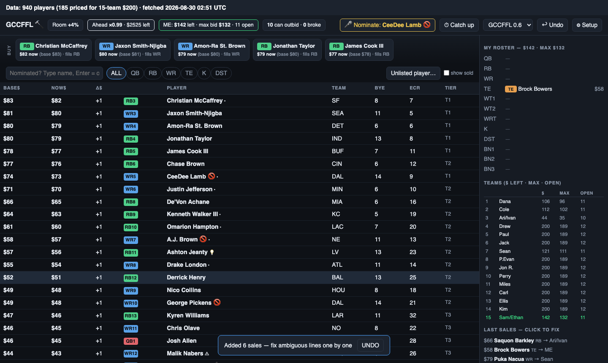

# Fantasy Draft Boards

Two offline-first fantasy football draft boards, one for a snake draft and one for a live in-person auction, plus a Python pipeline that prices every player so the auction values add up to the exact money in the room.

Built for my own 2026 leagues (a 12-team ESPN snake draft and a 15-team in-person auction), with Claude Code.



## Why it exists

The auction is run out loud in a room: one person calls each sale, nothing online tracks it, and the venue wifi can't be trusted. Stock auction values assume 12 teams and standard scoring, but this league had 15 teams, 0.6 points per reception and a receiver-heavy roster, so every off-the-shelf sheet mispriced it. I wanted a board that re-prices everyone live as money leaves the room, keeps every team's budget straight, and runs with no internet.

## How it works

**Pricing pipeline (`tools/fetch_data.py`, Python stdlib only)**

- Merges three free sources into `data/players.json`: FantasyPros expert consensus ranks and tiers (read from the JSON embedded in its rankings pages), FantasyFootballCalculator ADP and standard deviation, and ESPN's draft ranks and market auction values. Names are normalized (suffixes, punctuation) and defenses are keyed by team code, since each source names them differently.
- **Values that close.** ESPN's auction curve gives the price shape at each position. Those dollar rungs are reassigned in each format's expert-rank order, then scaled so the draftable pool sums to `teams x budget` with a $1 floor. The money that matters is the discretionary pool, `teams x budget - roster slots`, the dollars above the floors. Kickers, defenses and the deep tail land at $1 on their own.
- **Pool depth from the roster.** Per-team demand at each position comes from the mandatory slots plus a share of each flex and bench spot, so a 1-RB, 4-receiver roster drafts deeper at WR than a standard sheet assumes. `--teams N` re-prices the whole room.
- **Custom scoring as a blend.** 0.6 PPR is not a format any source publishes, so it is ranked as a weighted blend of the half-PPR and full-PPR expert ranks (20% of the way toward full).
- **Refuses bad data.** If ESPN's feed is down, every weight goes to zero and the whole board would silently become $1. The fetcher asserts at least 100 players price above $1 before it overwrites anything.

**Auction board (`auction.html`, one file, no framework)**

- **Live inflation.** `(cash left - open slots) / (pool value left - players left)`, clamped, re-prices every remaining player after each sale. The top bar shows how hot the room is running.
- **Max bid guard.** Each team's max legal bid is `money left - (open slots - 1)`, so nobody can strand themselves with unfillable slots. A counter shows how many rivals can still outbid you. At zero, everything left is yours at $1 over.
- **About 5 keystrokes per sale.** Type a few letters, Enter, price, Enter, buyer, Enter. Buyers can be a team number, part of a name, `m` for me or `u` for unknown. A name that matches two teams comes back ambiguous and is never guessed, which the tests check directly.
- **Catch-up import** for arriving late: paste one line per sale, preview each line as accepted or flagged, then apply. It rejects out-of-range team numbers, misspelled buyers and the same player twice in one paste instead of quietly corrupting budgets.
- **Undo and edit.** Every change pushes a snapshot. Any past sale can be fixed or deleted and all budgets recompute.
- **Recommendations.** Buy targets come from value, positional need and tier cliffs. Nomination picks push expensive players you don't want, to drain rivals' money. Late in the draft it switches to players you can win for $1. Kickers and defenses stay out until the skill slots are filled. A hardcoded team preference (my family's teams) nudges buy picks only, never the dollar values.
- **News flags.** `data/notes.json` holds injury and role notes (with sources) that show on the sale card.
- **Works anywhere.** `tools/build_standalone.py` inlines the board, player values and news flags into one HTML file that runs from a double-click with no server. Storage calls are wrapped in try/catch because some browsers throw on `localStorage` from `file://`. `tools/serve.py` also binds to the LAN, so a phone on the same hotspot is a live backup.

**Snake board (`draft.html`)**

- **"At your pick" odds.** Each player's draft position is modeled as normal around a market ADP (blended with ESPN's rank, since a casual room drafts off ESPN's default list) with the source's standard deviation, using a logistic approximation of the normal CDF. The odds are conditional on the player still being there now, so a faller doesn't read as 2%.
- **Tier-aware recommendations.** The last player left in a tier at a position gets a bonus over a slightly higher-ranked player from a deep tier.
- **Live ESPN sync** (`tools/espn_sync.py`). Polls the league's public draft feed, matches picks to the local player list with the same name rules as the fetcher, and writes `data/espn_picks.json`. The board ingests it without duplicating manual entries.
- **Readable by an agent mid-draft.** The board POSTs its full state after every pick, and `serve.py` writes it atomically to `data/state.json`, so a Claude Code session could read the live board and suggest picks.

## Stack

Plain HTML, CSS and JavaScript (no build step), Python 3 standard library for the data tools, Playwright for browser tests and screenshots. Pillow for the optional how-to guide builder.

## Run it locally

```bash
python3 tools/serve.py                  # http://localhost:8712/auction.html and /draft.html
```

The boards load `data/players.json`, a snapshot fetched Aug 30, 2026. To refresh it:

```bash
export ESPN_LEAGUE_ID=your-espn-league-id   # ESPN's auction values come from this endpoint
python3 tools/fetch_data.py                 # rebuild data/players.json
python3 tools/fetch_data.py --teams 12      # re-price for a different room size
python3 tools/fetch_data.py --sheet         # printable paper fallback, data/auction_sheet.html
python3 tools/build_standalone.py           # one self-contained auction board file
python3 tools/espn_sync.py                  # live pick sync for the snake board
python3 tools/make_mock.py                  # seeded mock-auction script with an answer key, for practice
```

Tests (with `serve.py` running, Playwright installed globally):

```bash
NODE_PATH=$(npm root -g) node tools/test_auction.cjs   # prints ALL AUCTION CHECKS PASSED
```

## Status and limits

- **Built for one season.** The defaults (15 teams, $200, 12 roster spots, 0.6 PPR, placeholder team names) match one league. Change them in the board's Setup panel. Team names in this repo are placeholders.
- **Unofficial data sources.** FantasyPros values are read from JSON embedded in its pages, and ESPN's fantasy API is undocumented. Either can change without notice and break the fetcher.
- **ESPN specifics are hardcoded.** The 2026 season and my ESPN team id live in `tools/espn_sync.py`, and live sync only works for public leagues.
- **The snake board's test suite is stale.** `tools/test_board.cjs` still expects 16 rounds after the league moved to 17. The auction suite is current.
- **No accounts, no shared state.** Each board saves to the browser's `localStorage`, so two devices don't share a draft. The auction board can copy its state as JSON and restore it on another device through Catch up.

## Data

Player rankings and ADP in `data/players.json` come from FantasyPros, FantasyFootballCalculator and ESPN, as fetched on Aug 30, 2026. Notes in `data/notes.json` cite their news sources inline.
